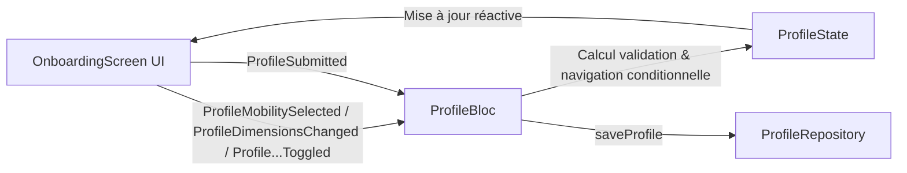

# Architecture Mobile Astrea

## Objectif

Cette page documente l'architecture locale de l'application mobile Flutter `Astrea-EIP/app-mobile`.

## Règles Fondamentales

- L'interface utilisateur mobile, les parcours interactifs et l'intégration des fonctionnalités matérielles appartiennent à ce dépôt.
- La logique métier backend et l'état des environnements de déploiement n'appartiennent pas à ce dépôt.
- Les normes transversales d'ingénierie sont maintenues dans le handbook central (`Astrea-EIP/docs`).

---

## Organisation Modulaire (Feature-First)

Le projet adopte une organisation **Feature-First / Clean Architecture** modulaire :

```
lib/
├── core/
│   ├── network/                # Clients HTTP, intercepteurs et configuration réseau
│   ├── theme/                  # Fondations Figma, design tokens, typographie, accessibilité
│   └── widgets/                # Composants transversaux partagés
├── features/
│   └── onboarding/             # Module profil d'accessibilité utilisateur
│       ├── data/
│       │   ├── models/         # Modèles de données immuables & validation métier
│       │   └── repositories/   # Contrats d'accès aux données & mocks
│       └── presentation/
│           ├── bloc/           # Gestion de l'état (BLoC, événements, états)
│           ├── screens/        # Écrans PageView et écran de confirmation
│           └── widgets/        # Composants visuels atomiques & accessibles
└── main.dart                   # Point d'entrée de l'application & injection de dépendances
```

---

## Module Profil d'Accessibilité (Onboarding)

### 1. Modèles de Données (`features/onboarding/data/models/`)

- **`MobilityType`** : Énumération des modes de déplacement (`manualWheelchair`, `electricWheelchair`, `walkingWithAssistance`, `pedestrian`, `stroller`).
  - Détermine conditionnellement le besoin de dimensions via `requiresDimensions`.
  - Fournit des libellés et descriptions détaillés 100% en français.
- **`WheelchairDimensions`** : Mensurations en centimètres de l'équipement :
  - `widthCm` (largeur : 0 à 200 cm),
  - `lengthCm` (longueur : 0 à 250 cm),
  - `maxStepHeightCm` (hauteur max de marche/bordure franchissable : 0 à 50 cm).
  - Validation intrinsèque `isValid`.
- **`RoutePreferences`** : Préférences de routage personnalisées :
  - `dogFriendly` (chiens d'assistance / de compagnie),
  - `avoidStairs` (éviter impérativement les escaliers),
  - `avoidSteepSlopes` (éviter les pentes > 6%),
  - `avoidUnevenSurfaces` (éviter pavés, sols instables, graviers),
  - `preferElevators` (privilégier les ascenseurs fonctionnels).
- **`AccessibilityProfile`** : Modèle racine agrégeant le type de mobilité, les dimensions optionnelles et les préférences.

### 2. Gestion de l'État : Pattern BLoC (`features/onboarding/presentation/bloc/`)

La navigation multi-étapes et la validation en temps réel reposent sur `flutter_bloc` :



#### Événements (`ProfileEvent`)
- `ProfileMobilitySelected` : Sélection du profil de mobilité.
- `ProfileDimensionsChanged` : Synchronisation des dimensions saisies.
- `ProfileDogFriendlyToggled`, `ProfileAvoidStairsToggled`, etc. : Bascule des filtres d'itinéraire.
- `ProfileNextStepRequested` : Avancement à l'étape suivante (validation préalable, saut automatique de l'étape dimensions pour les profils non-fauteuil).
- `ProfilePreviousStepRequested` : Retour en arrière respectant le saut conditionnel.
- `ProfileSubmitted` : Soumission du profil validé au repository.
- `ProfileResetRequested` : Réinitialisation pour nouveau test / démo.

#### États (`ProfileState`)
- `currentStep` : Index de l'étape courante (0: Mobilité, 1: Dimensions, 2: Préférences, 3: Récapitulatif).
- `status` : Statut de soumission (`initial`, `loading`, `success`, `failure`).
- `isCurrentStepValid` : Validité temps réel pour activer/désactiver le bouton d'action principal.

---

## Design System & Conformité Accessibilité (WCAG 2.2 AA / RGAA)

Le thème (`lib/core/theme/app_theme.dart`) implémente strictement les tokens des **Figma Foundations d'Astrea** :

| Token Figma | Valeur Hex | Usage & Règle d'Accessibilité |
|---|---|---|
| `primary` | `#4CAF50` | Fond vert des boutons interactifs |
| `primaryStrong` | `#2E7D32` | Texte et icônes verts sur fond clair (Ratio ≥ 4.5:1 garanti) |
| `onPrimary` | `#212529` | Texte sombre sur fond vert `primary` (Ratio certifié 5.55:1) |
| `accent` | `#FF9800` | Fond orange d'accentuation |
| `accentStrong` | `#B34700` | Éléments orange sur fond clair |
| `page` | `#FAF7F2` | Fond de page chaleureux et doux |
| `surface` | `#FFFFFF` | Fond des cartes et conteneurs |
| `border` / `borderStrong` | `#DDD8CE` / `#7C847F` | Séparateurs et bordures contrastées (≥ 3:1) |
| `error` | `#B3261E` | Alertes et retours d'erreur |
| `brandGradient` | `#43A047` → `#FFA726` | Dégradé décoratif continu appliqué sur le stepper |

### Règles d'Inclusivité Appliquées
1. **Ratio de Contraste** : Tous les textes et icônes d'action respectent un ratio de contraste supérieur ou égal à 4.5:1 (conforme RGAA critère 3.2 et WCAG AA).
2. **Cibles Tactiles** : Tous les boutons interactifs (`ElevatedButton`, cartes de sélection, switchs) disposent d'une hauteur minimale de 52 dp, dépassant le minimum de 48×48 dp requis par le RGAA.
3. **Mise à l'Échelle Typographique** : Conteneurs scrollables (`SingleChildScrollView`) et `FittedBox` prévenant tout dépassement de layout (`RenderFlex overflow`) lors de l'agrandissement de la police système jusqu'à 200%.

---

## Stratégie de Tests

La suite de tests automatisée couvre 100% de la chaîne de valeur :

1. **Tests Unitaires Thème** (`test/core/theme/app_theme_test.dart`) : Conformité des tokens de couleurs, espacements, rayons et typographie.
2. **Tests Unitaires Modèles** (`test/features/onboarding/data/models/accessibility_profile_test.dart`) : Sérialisation JSON, valeurs limites des dimensions, égalité immuable.
3. **Tests Unitaires Repository** (`test/features/onboarding/data/repositories/profile_repository_test.dart`) : Persistance en mémoire et gestion des erreurs de communication.
4. **Tests Unitaires BLoC** (`test/features/onboarding/presentation/bloc/profile_bloc_test.dart`) : Transitions d'état, validation conditionnelle et flux d'erreurs.
5. **Tests de Composants Widgets** (`test/features/onboarding/presentation/widgets/`) :
   - `onboarding_progress_bar_test.dart` : Rendu du dégradé continu et des segments.
   - `mobility_type_card_test.dart` : Rendu des cartes, pastilles et sélection.
   - `preference_toggle_tile_test.dart` : Interactivité des interrupteurs adaptatifs.
   - `dimensions_step_form_test.dart` : Validation en direct des champs numériques.
6. **Tests d'Intégration Parcours** (`test/features/onboarding/presentation/screens/`) :
   - `onboarding_screen_test.dart` : Parcours piéton complet (saut conditionnel d'étape), parcours fauteuil (saisie des dimensions, navigation retour), soumission et affichage du succès.
   - `onboarding_success_screen_test.dart` : Synthèse récapitulative et bouton de réinitialisation.

```bash
# Exécution de la suite de tests
flutter test

# Analyse statique du code
flutter analyze

# Vérification du formatage
dart format --set-exit-if-changed .
```
